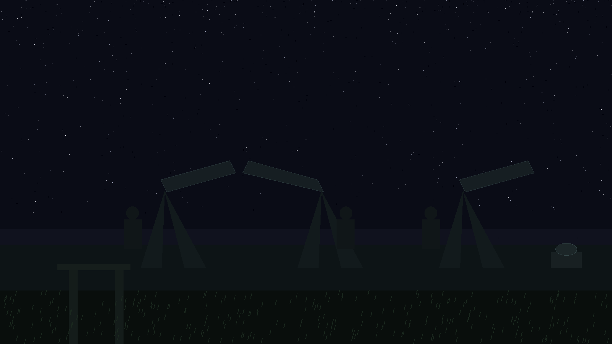

# crypto-rate-limiter-bypass-tester

Title block: the name above is set in Blaka in moon cream on a dream violet chart plate, ruled beneath with a fine line, with a small filtered torch drawn beside the first heading only and nowhere repeated as decoration.

# crypto-rate-limiter-bypass-tester
A local timing benchmark for HMAC, HKDF, signature, and AES operations. It generates its own keys and data, runs the selected operation locally for the requested number of iterations, and logs the total and average time. It sends no network requests and tests no rate limiter. - Focused on Basic cryptographic operations

> Log note, entered first: the repo name is a name, not a description. This program tests no rate limiter, bypasses nothing, and sends no network request of any kind. It times one named operation in a loop on this one machine.

## Install
`git clone https://github.com/ShadowStrikeHQ/crypto-rate-limiter-bypass-tester`

> Log note: the operation is required. The parser refuses a run without one, and no control on this program has a short form, the help control apart.

## Usage
`python3 main.py [params]`

> Log note: the guards run before any timing begins. Iterations below 1, an HKDF length below 1, an AES key size other than 16, 24, or 32 bytes, or an HMAC key size below 1 byte ends the run with an error logged and a failure ending.

Each operation is timed over the requested iterations and the average
is logged. The exit code is 0 when the selected operation completes
and 1 when it fails or the arguments cannot produce a run (iterations
below 1, an HKDF length below 1, or an AES key size other than 16, 24
or 32 bytes).

> Log note, a correction kept visible: the parser help line for the iterations control suggests the count may bear on rate limiting. On this program it does not, because the program transmits nothing. The line is a relic of the repo name and is recorded here rather than repeated.

## Parameters
- `--operation`: The cryptographic operation to test (hmac, hkdf, signature, aes).
- `--iterations`: The number of iterations to perform.
- `--key_size`: The size of the key to use in bytes (default: 32).
- `--hkdf_length`: The length of the output for HKDF (default: 32).
- `--signature_algorithm`: The signature algorithm to use (ecdsa, rsa). Relevant for signature testing.
- `--aes_mode`: The AES mode of operation (cbc, ctr).  Relevant for AES testing

## License
Copyright (c) ShadowStrikeHQ

## Facts from the code, stated in the prose

Facts from the code, stated in the prose. This record names: --operation, hmac, hkdf, signature, aes, --iterations, --key_size, --hkdf_length, --signature_algorithm, ecdsa, rsa, --aes_mode, cbc, ctr, SHA256, SECP256R1, PSS, PKCS7, cryptography>=42.0.0, exit code 0, exit code 1. Defaults the README omits are stated here as code facts: iterations default 100, signature algorithm default ecdsa, AES mode default cbc. The key size and HKDF length defaults are both 32. The RSA shape uses a 2048 bit key. No key, signature, plaintext, or ciphertext is printed in any run, and nothing in this record prints one either.
