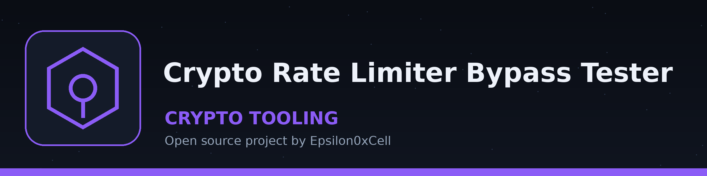

# crypto-rate-limiter-bypass-tester
Tests for vulnerabilities in rate limiting implementations related to cryptographic operations (e.g., signature verification, key derivation) that could lead to resource exhaustion. - Focused on Basic cryptographic operations

## Install
`git clone https://github.com/ShadowStrikeHQ/crypto-rate-limiter-bypass-tester`

## Usage
`./crypto-rate-limiter-bypass-tester [params]`

Each operation is timed over the requested iterations and the average
is logged. The exit code is 0 when the selected operation completes
and 1 when it fails or the arguments cannot produce a run (iterations
below 1, an HKDF length below 1, or an AES key size other than 16, 24
or 32 bytes).

## Parameters
- `--operation`: No description provided
- `--iterations`: The number of iterations to perform.  Higher numbers may trigger rate limiting.
- `--key_size`: No description provided
- `--hkdf_length`: No description provided
- `--signature_algorithm`: No description provided
- `--aes_mode`: No description provided

## License
Copyright (c) ShadowStrikeHQ
